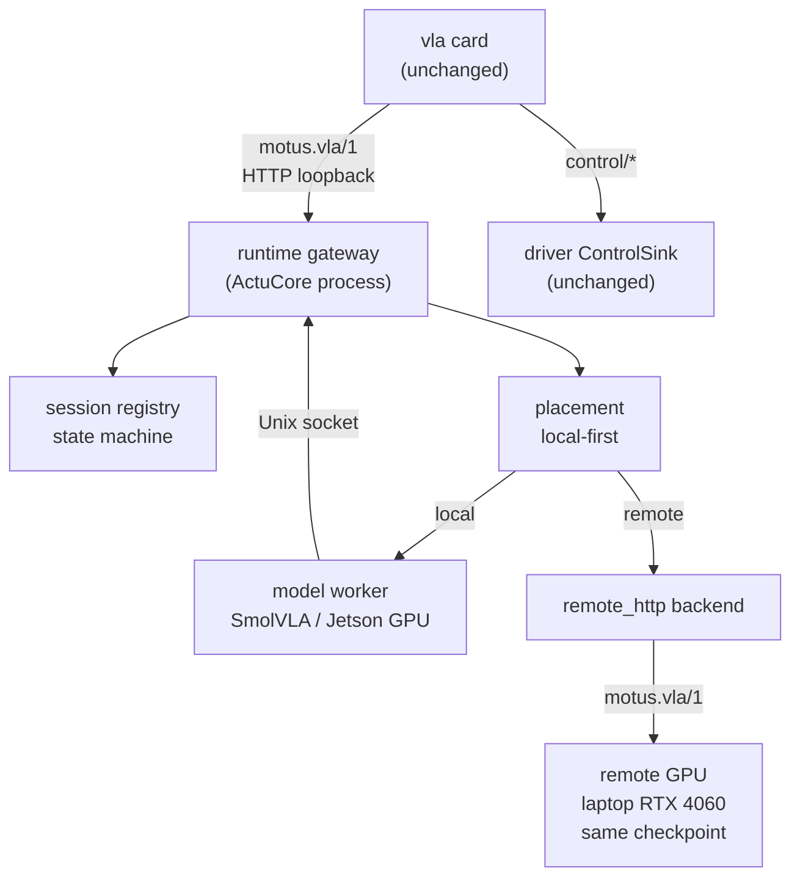

# PhanthyMotus Model Runtime：VLA 执行层

**版本**：v0.2
**状态**：设计草案，待团队评审
**Tracking issue**：[#1](https://github.com/Caden-1224/phanthymotus/issues/1)

## 1. 定位与边界

PhanthyMotus 已经有完整的 `agent-core`、`perception`、`actucore`、driver 和真机链路；VLA 目前由 `vla` 卡片里的 provider 直接执行。随着 VLA 从演示走向真实任务，问题越来越不在“模型能不能做”，而在“模型怎么稳定地跑”：

- model 和卡片同进程，VLA 崩溃或 OOM 会影响同一 ActuCore 进程里的其他卡片；
- 换模型、换硬件往往要换镜像或新 provider；
- inference、health、cancel 互相阻塞；
- 同一个 VLA checkpoint 无法在本地 GPU 和远端 GPU 之间按统一接口切换；
- 停止或切换模型后，进程内的 CUDA context 不会真正归还给 OS。

本方案新增的是 **ActuCore 内部的 model runtime**：把 VLA 的 model execution 从卡片进程中剥离，提供进程隔离、session 生命周期、多执行目标和 local-first placement。它不是一个新模型，也不是 ModelHub 的替代品。

**一句话边界**：v1 做 **多执行目标（H1）+ 进程隔离（H4）** 的主线，以及 **local-first + remote 溢出/failover（H3-lite）** 的增量；**不做模型算子级的异构协同（H2）**。

### 1.1 与现有系统的关系

- `vla` 卡片、provider 协议、画布、DDS、driver 的 `ControlSink` 和 watchdog 保持不变。
- **ModelHub 继续负责 agent loop 的 LLM/VLM serving**；本 runtime 只服务 ActuCore 的 execution model，不与 ModelHub 合并。
- 第一版只接 VLA；perception 模型不纳入本 runtime。
- 术语按 [GLOSSARY.md](../GLOSSARY.md)：`model runtime`、`model worker`、`runtime gateway`、`execution target`、`session`、`placement`、`failover`。

### 1.2 能力边界

| 能力 | v1 是否做 | 说明 |
|---|---|---|
| 多执行目标（H1） | 是 | 同一 checkpoint 可在本地 Jetson GPU、远端 GPU 上执行；卡片代码不变 |
| 进程隔离（H4） | 是 | 一个模型一个 worker 进程；worker 崩溃不带走 ActuCore |
| local-first placement / remote failover（H3-lite） | 是，作为增量 | 按 session 粘住；local 过载或故障时才考虑 remote |
| 模型算子级异构协同（H2） | **否** | 不把 SmolVLA 切到 CPU + GPU + DLA 同时算；见 ADR-0002 |
| 每 chunk 动态换机器 | **否** | 会造成动作连续性和时序问题 |
| 生产级远端 serving / 多租户调度 | **否** | 笔记本远端只是验证 target，不是生产服务 |

### 1.3 为什么不是重复 ROS2

**ROS2 是机器人总线，不是 model runtime。** PhanthyMotus 的 driver、sensor、actuator 和 `control/*` 继续走 ROS2/DDS；本方案不替换它们，也不把 SlotNexus 的 ZeroMQ/Gateway/Manager 通信层搬进来。

| 层 | ROS2 已经提供 | 本 runtime 提供 |
|---|---|---|
| 进程间通信 / 发现 | DDS pub/sub、service/action、节点发现 | 不重复；控制链路继续用 ROS2 |
| 进程隔离 | 独立进程/节点的 OS 隔离 | supervisor、health、restart、worker 生命周期 |
| 模型生命周期 | 无 | 权重加载、ready/loading、warmup、idle reap、显存回收 |
| Backend / placement | 无 | 同一 checkpoint 的 local/remote 执行目标与放置 |
| 远端推理 | DDS 被限制在本机 loopback，跨机不可用 | `motus.vla/1` over HTTP，正是现有 `vla_cloud` 的边界 |
| 机器人安全 | driver 的 `ControlSink` 和 watchdog | 不碰；runtime 只影响出块 |

ROS2 的 lifecycle node 能管节点状态（configure/activate/deactivate/cleanup），但不管子进程 spawn、checkpoint 加载、GPU context、worker 崩溃重启或 remote placement——这些才是本 runtime 的内容。把 VLA 推理做成 ROS2 service 还会把多 MB 的 JPEG 观测塞进 DDS，并让远端笔记本必须加入 DDS 图；现有的 `motus.vla/1` HTTP 契约反而更简单，也不用新增第二套推理协议。

## 2. 目标

1. **Process isolation**：一个模型一个 worker 进程；kill worker，ActuCore 和其他卡片存活，Perception、driver 不受影响；机器人安全仍由 driver watchdog 保证；runtime 能检测并恢复。
2. **多执行目标**：同一 model、同一接口可在 Jetson GPU、远端 GPU 之间切换；卡片代码不变。CPU 只用于离线对照，不作为真机控制目标。
3. **Session 生命周期**：`start / infer / cancel / status / close` 有明确状态、deadline、bounded queue 和结构化错误；inference 满载时 health/cancel 仍能及时响应。
4. **Local-first placement**：默认本地 GPU；本地队列/延迟超过阈值时，新 session 可以放到远端；local worker 故障时，当前 session 尽力切到远端；local 恢复后 failback。
5. **可验证**：mock、Orin、笔记本远端、条件允许时的真机，都有可复现的指标和 A/B 记录。
6. **可交接**：设计文档、deployment、config、tests、回滚开关、A/B 报告齐全，形成 PhanthyMotus PR。

### 2.1 非目标

- 不做“异构协同/异构加速”的宣称：v1 不会让一个 VLA 同时使用 CPU + GPU + DLA。
- 不做 per-chunk placement，不把动作块拆到不同机器上执行。
- 不做多租户生产调度器、跨主机集群、自动扩缩容。
- 不把 ModelHub 的 LLM/VLM serving 合并进来。
- 不承诺模型精度、成功率或单次推理延迟的提升；这些不是本 runtime 的优化目标。

## 3. 架构



Runtime 只负责 model execution；action chunk 仍由 `vla` 卡片按现有链路发布，最终在真机上完成任务。worker 的崩溃或超时只影响出块，不改变 driver 的 `ControlSink` 和 watchdog；机器人安全仍由现有驱动链路保证。

### 3.1 进程与通信

- **runtime gateway** 运行在 ActuCore 容器内，对 `vla` 卡片暴露 loopback HTTP 的 `motus.vla/1`。
- **model worker** 是独立进程，由 supervisor 启动和回收；worker 不承担 ROS/DDS 职责。
- 卡片 → gateway 使用 `motus.vla/1` HTTP；gateway → worker 使用 Unix domain socket / `multiprocessing.connection`，只传 JSON 和 action chunk。
- worker 用 `spawn` 启动，不用 `fork`，避免继承 ActuCore 已加载的 CUDA/运行时状态。

### 3.2 关键决策

| 决策 | 选择 |
|---|---|
| Runtime 落点 | `actucore/runtime/`，同一个 ActuCore 容器；不新增顶层服务 |
| Worker 粒度 | 一个模型一个 worker 进程；第一版只有 VLA |
| Session 边界 | `vla` 卡片 start → stop；`execute` 换任务不换 session、不换 target |
| 卡片接入 | v1 用现有 `vla_cloud` provider 指向本地 runtime；`motus_runtime` provider 作为 stretch |
| Placement | local-first；新 session 可 remote 溢出；当前 session 只在 local health 失败时 failover |
| Failback | local worker 恢复健康后，后续 session 回 local；当前 session 不来回切 |
| Cancel | 软取消 = 停止发布并丢弃在飞结果；硬取消 = kill worker；不声称能抢占 PyTorch forward |
| Model identity | local 与 remote 必须加载同一 checkpoint；`/capabilities` 必须一致，否则不接管 |
| 安全 | driver 的 `ControlSink` 和 watchdog 不变；无命令即 hold |

## 4. 运行契约

### 4.1 状态机

```text
new → ready → busy → ready
             ↘ cancelling → ready
             ↘ recovering → ready
任何状态 → terminated（close / exit）
```

- 同一 session 同时只允许一个在途 infer；再次 infer 返回 `busy`。
- `cancel` 置取消标志；backend 在耗时循环中协作检查；不检查的后端只能丢弃结果或 kill worker。
- worker 异常退出时进入 `recovering`；supervisor 重启 worker，ready 后恢复。
- `status` 返回 session state、in-flight、inference count、target、last error。
- `close` 终止 session 并释放 worker（或标记 idle reap）。

### 4.2 接口

Runtime gateway 对 `vla_cloud` 兼容的接口：

- `GET /capabilities`：返回 `schema: motus.vla/1`、model、action_dim、chunk_size、control_hz、needs_state、n_cameras、supports_rtc 等；必须与直接 provider 的 capabilities 一致。
- `POST /infer`：接收 `motus.vla/1` 请求，返回 action chunk。
- `GET /healthz`：必须快速返回缓存状态；不能等待模型推理。
- `GET /status`：session、target、queue depth、worker state、last error（内部/调试用）。
- `POST /close`：停止 session、回收 worker（由 `motus_runtime` provider 或后续版本使用）。

`vla_cloud` v1 只使用前三个；`/status` 和 `/close` 不要求卡片感知。

### 4.3 Placement 策略

默认 `local_first`：

1. 新 session 优先 local。
2. 如果 local worker 不健康，或 local queue depth 超过阈值，或 local EWMA p95 超过阈值，且 remote healthy 且 `capabilities` 一致，则新 session 放 remote。
3. 当前 session 粘住 target；只有 local health 失败才 failover 到 remote。
4. local 恢复健康并稳定后，后续新 session 回 local；当前 session 不强制切回。
5. 所有切换记录 `placement_decision`、`failover_count`、`failback_count` 和原因。

`remote` 是测试/溢出 target，不是生产服务；不承诺 remote 一定更快。远端 RTT + 推理必须落在 driver 的 `max_obs_age_ms` 和 watchdog 预算内，否则 remote 不能用于控制。

## 5. 开发阶段

> 阶段按依赖顺序排列；不写时间。

| 阶段 | 内容 | 退出条件 |
|---|---|---|
| **P0 Baseline** | 在 Orin 6 上冻结当前 in-process 基线：`first_chunk_ms`、`chunk_gap_p99`、`stall_count`、`infer_p95`、`navi_jitter_p99`、`MemAvailable`、kill ActuCore 恢复时间；没有真机时用 mock/空跑 | 基线报告可复现；记录 commit、配置、checkpoint；不改代码 |
| **P1 Runtime skeleton + mock** | 新增 `actucore/runtime/`：gateway、session registry、supervisor、`MockBackend`、`DelayBackend`；`vla_cloud` 指向本地 runtime；测试 busy/timeout/cancel/kill/restart；`tools/runtime_load.py` 雏形 | `vla` 卡片零改动跑通 mock；kill worker 后 ActuCore 存活；worker 可重启；契约测试通过 |
| **P2 Local real backend** | `SmolVLAWorker` 独立进程；同 checkpoint、同观测契约；权重加载、health、supervisor restart；native provider vs runtime local 的 A/B | 输出 chunk 语义一致；`chunk_gap_p99` / `first_chunk_ms` 不退化超过约定阈值；kill worker 5/5；记录常驻内存 |
| **P3 Remote target + placement** | `remote_http` backend；笔记本 RTX 4060 上的 `motus.vla/1` server；local-first placement；`runtime_load.py` 多 session 合成负载；failover/failback | 同一 checkpoint 的 `/capabilities` 一致；placement 预期决策 10/10；failover 5/5；无 per-chunk 切换；记录 remote RTT / p95 |
| **P4 Real-machine validation（条件性）** | 真机载体确认后：native vs runtime local 的 A/B；kill worker、cancel、recovery；success rate 只做描述性记录。若载体未确认，P4 标 `N/A` | 无条件部分：kill/cancel/recovery 场景通过；条件部分：有真机报告；无真机则明确写 `N/A`，不声称“真机 VLA A/B” |
| **P5 Handoff** | `docs/model-runtime.md`、deployment、config、tests、回滚开关、A/B 报告、PR | 文档、配置、测试、回滚路径齐全；PR 可评审 |

### 5.1 PR 切分

三个 stacked PR，每个都能独立跑测试：

1. **PR1（P1）**：runtime skeleton、mock/delay backend、session 状态机、`vla_cloud` 兼容层、契约测试。
2. **PR2（P2）**：local SmolVLA worker、supervisor/restart、Orin baseline/A-B。
3. **PR3（P3 + P5）**：remote backend、placement policy、笔记本 server 工具、文档和报告。若 remote target 无法满足 RTT/同 checkpoint 条件，PR3 收在 H1+H4，H3-lite 标 future work，不把第二个模型作为并行主线。
4. **Stretch**：`motus_runtime` provider（cached health、`/close`、显式 cancel）。

## 6. 验收指标

| 指标 | 说明 | 用途 |
|---|---|---|
| `actucore_alive` | kill worker 后 ActuCore 是否存活 | 安全/可靠性 gate |
| `worker_restart_count` / `recovery_time_s` | worker 重启次数与恢复出块时间 | 可靠性 |
| `cancel_ack_ms` / `gpu_release_ms` | 取消确认与 GPU 释放 | 取消语义 |
| `chunk_gap_p99` / `stall_count` | 动作连续性 | 性能回归 |
| `first_chunk_ms` / `infer_p95` | 首块与推理延迟 | 性能回归 |
| `navi_jitter_p99` | VLA 运行时 navi 的命令抖动 | 进程隔离收益 |
| `mem_available_after_stop_mb` | 停止/切换后显存/内存回收 | H4 收益 |
| `placement_decision_accuracy` | 合成负载下是否符合预期 target | H3-lite |
| `failover_count` / `failback_count` / `switch_count` | 切换行为 | H3-lite |
| `success_rate` | 真机任务成功率；无真机则 `N/A` | 描述性，不作唯一 gate |

### 6.1 验收 gate

- **安全/可靠性**：kill worker 5/5 ActuCore 存活、无异常运动、worker 可恢复；cancel 5/5 旧 chunk 不再提交。
- **性能开销**：local runtime vs native provider 的 `chunk_gap_p99` / `first_chunk_ms` 不退化超过约定阈值；超出时必须有解释和取舍记录。
- **Placement**：合成多 session 负载下，预期决策 10/10；failover 5/5；不允许 per-chunk 切换。
- **真机**：仅在载体确认后执行；success rate 作为描述性数据，不用小样本宣称“非劣”。
- **不宣称**：H2 异构协同、模型精度提升、单次推理加速。

## 7. 交付物

1. `actucore/runtime/`：gateway、session、supervisor、worker、backends、placement。
2. `tools/runtime_load.py`：多 session 合成负载 / placement 验证工具。
3. `tools/remote_vla_server.py`：笔记本远端 `motus.vla/1` server（测试工具，不是生产服务）。
4. `docs/model-runtime.md`：架构、协议、状态机、错误码、deployment、observability。
5. tests：backend 契约、session busy/timeout/cancel、worker kill/restart、placement policy、`vla_cloud` 集成。
6. 真机 A/B 报告（条件性）：baseline vs runtime local；kill/cancel/recovery；remote matrix；资源。
7. PhanthyMotus PR（3 个 stacked PR）。

## 8. 开放依赖与风险

### 8.1 开放依赖

- **真机载体（TBD）**：天轶 2.0 / G1 / SO-100 / 只能 mock。进入 P4 前必须确认；未确认则 P4 标 `N/A`，不写“真机 VLA A/B”。
- **笔记本远端**：RTX 4060、8 GB 显存、有线 LAN、能装 CUDA PyTorch + LeRobot；必须加载同一 checkpoint。
- **H3-lite 备选**：如果笔记本远端无法满足 RTT/同 checkpoint 条件，第二个真实模型（perception 的 VOP/ASR）只作为备选，不与主线并行；两者都不可用则 H3 标 future work，交付 H1+H4。
- **Checkpoint**：`smolvla_base` 是 6 维 SO-100/SO-101，不能驱动天轶 26 维；若没有微调 checkpoint，真机 A/B 不可用。
- **评审/合并路径**：需要 mentor 指定 reviewer 和 PR 合并方式。

### 8.2 风险

- worker 常驻会增加一个进程和 CUDA context，运行中内存可能比 in-process 高；收益在停止/切换后的回收和故障隔离，必须实测。
- 远端 RTT + 推理可能超过 `max_obs_age_ms`；超过时 remote 只能做离线/非控制验证。
- 4060 laptop 可能比 Orin 慢；placement 的收益是尾延迟/可用性，不是平均速度。
- `vla_cloud.health()` 每 tick 发 HTTP（约 30 QPS）；如果影响 p95，PR3 加 `motus_runtime` provider 的 cached health。
- `vla_cloud.close()` 不会通知 runtime；v1 用 idle reap，stretch 用 `/close`。

## 9. 与 SlotNexus 的对应关系

参考 SlotNexus 的 runtime 契约与测试方法，不直接搬代码：

| SlotNexus | 本 runtime |
|---|---|
| `TaskChannel` 状态机（new/ready/busy/terminated、单流、cancel、taskinfo） | `runtime/session.py` |
| `IBackend`（JSON、deadline、cancel token、event sink） | `runtime/backends/*` 的 `ModelBackend` |
| `RuntimeNode`（setup/inference/cancel/taskinfo/exit） | runtime gateway 的 session 接口 |
| `EchoBackend` / `DelayBackend` | `MockBackend` / `DelayBackend` |
| `Unit Manager` 的 work_id 路由 | `PlacementManager`（把静态轮转换成 local-first / queue-latency score） |
| 一个模型一个节点进程 | 一个模型一个 worker 进程 |

不照搬：ZeroMQ/TCP/NDJSON、C++ 实现、静态轮转、RK3576 的 NPU/RKNN 细节。SlotNexus 的 MeloTTS CPU encoder + NPU decoder 是特定 backend 内部的分工，不是通用 H2 能力。

实现时可参考本地 SlotNexus checkout 的具体入口：`middleware/runtime/include/slotnexus/runtime/task_channel.hpp`（状态机）、`middleware/runtime/include/slotnexus/runtime/ibackend.hpp`（backend 契约）、`middleware/runtime/src/task_runtime.cpp`（work_id 路由与锁边界）、`middleware/services/node_host/runtime_node.cpp`（RuntimeNode 生命周期）和 `tests/core/unit/runtime_test.cpp`（busy/timeout/cancel/exit 测试）。只借契约与测试场景，不搬 C++/ZeroMQ 实现。

## 10. 决策记录

- [ADR-0001](adr/0001-model-runtime-lives-in-actucore.md)：v1 model runtime 放在 ActuCore 内，不新开顶层服务。
- [ADR-0002](adr/0002-heterogeneous-coexecution-out-of-scope.md)：v1 不做模型算子级异构协同。
